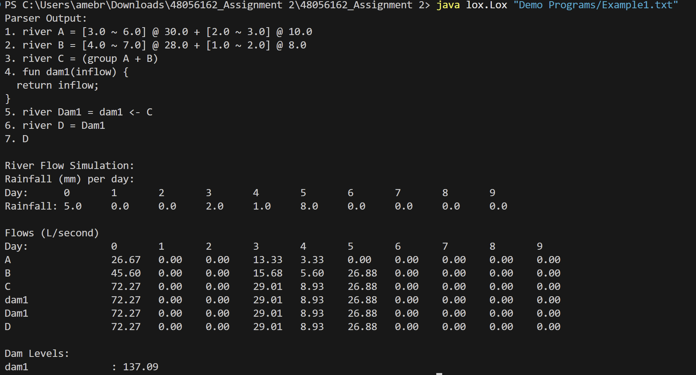
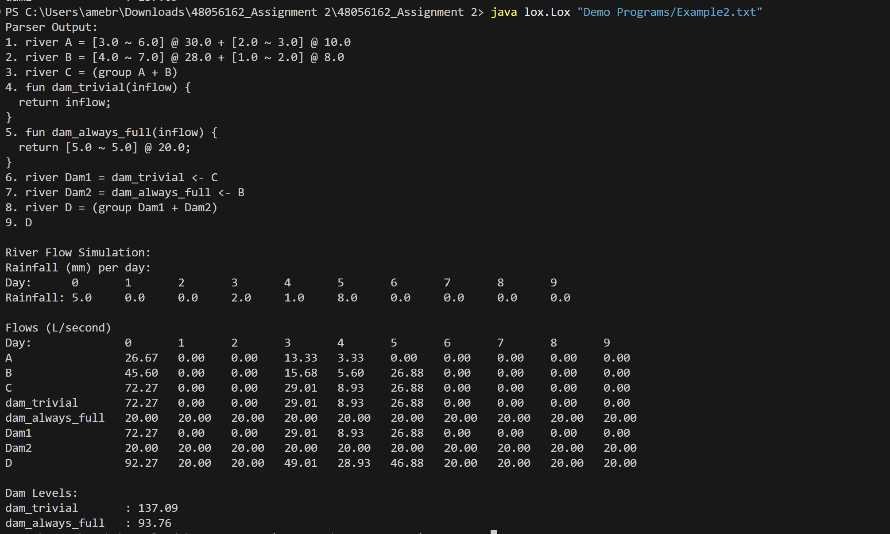
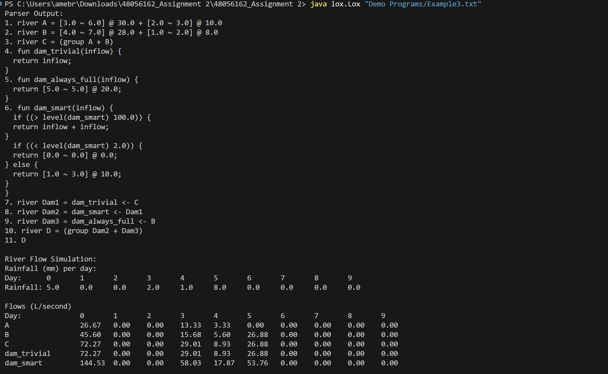
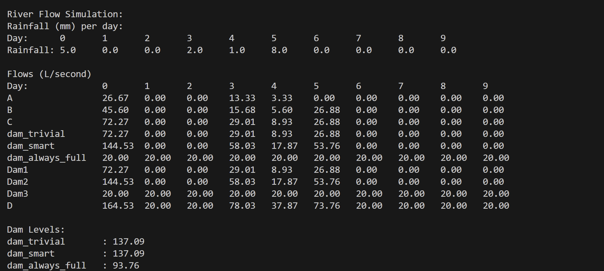

#  River Flow DSL Interpreter

A Java-based domain-specific language (DSL) and interpreter for modelling river flows, rainfall patterns, and programmable dam behaviour across a multi-day simulation.

The project extends a Lox-style interpreter architecture with domain-specific syntax for representing rivers and dams, allowing river systems to be described and evaluated through a small custom programming language.

---

##  Overview

The River Flow DSL provides a simple way to define river systems and simulate how water flows through them.

Using the language, a program can:

- Define rivers using rainfall-based flow patterns
- Combine multiple river flows
- Define programmable dam functions
- Apply dams to upstream rivers
- Simulate river flow across multiple days
- Track dam water levels
- Use conditional logic to change dam behaviour dynamically

The interpreter evaluates the program and produces flow information for the river and dam system over a fixed 10-day simulation period.

---

##  Key Features

### River Flow Modelling

River flows can be created using rainfall-pattern expressions and combined using arithmetic expressions.

```text
river A = [3 ~ 6] @ 30 + [2 ~ 3] @ 10;
river B = [4 ~ 7] @ 28 + [1 ~ 2] @ 8;

river C = (A + B);
```

### Rainfall Pattern Syntax

The DSL includes a custom rainfall-pattern representation:

```text
[peak ~ duration] @ total
```

For example:

```text
[3 ~ 6] @ 30
```

represents a rainfall/flow pattern with a peak position, duration, and total flow value.

---

### Programmable Dams

Dam behaviour is represented using functions.

A simple pass-through dam can return its incoming flow unchanged:

```text
fun dam_trivial(inflow) {
    return inflow;
}

river Dam1 = dam_trivial <- C;
```

The `<-` operator applies a dam function to an upstream river.

---

### Conditional Smart Dam

Dams can also make decisions based on their current stored water level.

```text
fun dam_smart(inflow) {
    if (level(dam_smart) > 100) {
        return inflow + inflow;
    }

    if (level(dam_smart) < 2) {
        return [0 ~ 0] @ 0;
    } else {
        return [1 ~ 3] @ 10;
    }
}
```

This allows the simulated dam to modify its release behaviour depending on its state during evaluation.

---

## Examples and Output

Three example programs are included in the [`examples`](examples/) directory.

### Example 1 — Basic River + Pass-Through Dam

Demonstrates:

- Rainfall-based river definitions
- Combining river flows
- A simple pass-through dam
- Downstream river evaluation



---

### Example 2 — Multiple Dam Behaviours

Extends the first example with two different dam functions:

- A pass-through dam
- A dam producing a constant flow pattern
- Multiple downstream dam outputs combined into a final river



---

### Example 3 — Smart Dam with Level-Based Control

The most advanced example combines multiple dams with conditional behaviour.

The smart dam checks its current level and changes its release strategy depending on whether the dam is nearly empty, operating normally, or above its defined threshold.

**Output — Part 1**



**Output — Part 2**



---

## Interpreter Architecture

The language follows a traditional interpreter pipeline:

```text
DSL Source Program
        │
        ▼
     Scanner
        │
        ▼
      Tokens
        │
        ▼
      Parser
        │
        ▼
 Abstract Syntax Tree
        │
        ▼
    Interpreter
        │
        ▼
 River & Dam Simulation
        │
        ▼
   Console Output
```

### Scanner

`Scanner.java` performs lexical analysis and converts the source program into tokens understood by the parser.

### Parser

`Parser.java` processes the token stream and constructs expressions representing language features such as:

- River declarations
- Arithmetic expressions
- Rainfall patterns
- Function definitions and calls
- Dam applications
- Conditional expressions
- Variables and assignments

### Abstract Syntax Tree

`Expr.java` defines the expression structures used to represent the parsed program.

The AST allows the interpreter to work with the program as structured language constructs rather than raw source text.

### Interpreter

`Interpreter.java` evaluates the parsed expressions and performs the river and dam simulation.

It handles river-flow evaluation, function execution, dam application, conditional behaviour and dam-level state during the simulation.

---

##  Project Structure

```text
river-flow-dsl-interpreter/
│
├── assets/
│   ├── Example1.output.png
│   ├── Example2.output.png
│   ├── Example3.output-part1.png
│   └── Example3.output-part2.png
│
├── examples/
│   ├── Example1.txt
│   ├── Example2.txt
│   └── Example3.txt
│
├── lox/
│   ├── AstPrinter.java
│   ├── Environment.java
│   ├── Expr.java
│   ├── Interpreter.java
│   ├── Lox.java
│   ├── LoxCallable.java
│   ├── LoxFunction.java
│   ├── Parser.java
│   ├── Return.java
│   ├── RuntimeError.java
│   ├── Scanner.java
│   ├── Token.java
│   └── TokenType.java
│
├── tool/
│   └── GenerateAst.java
│
├── .gitignore
└── README.md
```

---

##  Running the Interpreter

### Prerequisites

- Java Development Kit (JDK)
- A terminal or command prompt

Check that Java is installed:

```bash
java --version
javac --version
```

### Compile

From the project root, compile the Java source files.

#### Windows Command Prompt

```cmd
javac lox\*.java
```

#### PowerShell

```powershell
javac (Get-ChildItem lox\*.java).FullName
```

#### macOS / Linux

```bash
javac lox/*.java
```

### Run an Example

#### Windows

```cmd
java lox.Lox "examples\Example1.txt"
```

#### macOS / Linux

```bash
java lox.Lox "examples/Example1.txt"
```

You can replace `Example1.txt` with:

```text
Example2.txt
Example3.txt
```

to explore the more advanced dam behaviours.

---

##  Concepts Demonstrated

This project applies several programming-language and software-engineering concepts:

- Java
- Domain-Specific Language (DSL) design
- Lexical analysis
- Tokenisation
- Recursive-descent parsing
- Abstract Syntax Trees (ASTs)
- Interpreter architecture
- Expression evaluation
- Functions and environments
- Conditional evaluation
- Stateful simulation
- Custom language syntax

---

## Project Background

This project was developed as part of **COMP3000 – Programming Languages** at Macquarie University.

The coursework involved extending an expression language into an executable interpreter and designing language constructs for modelling river flows and programmable dams.

The project uses a **Lox-style interpreter structure** and course-provided/exemplar concepts as its foundation. The river-flow domain model, dam syntax and behaviour, rainfall-pattern handling, simulation logic, and associated language extensions were developed for the project.

This repository is published as part of my software engineering portfolio with permission to showcase the completed coursework.

---

## Author

**Mst Asma Ul Husna**  
Bachelor of Engineering (Honours) — Software Engineering  
Macquarie University